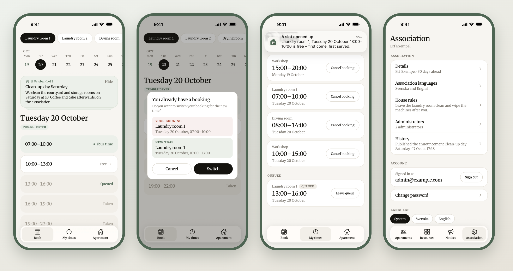

# BrfHub

Booking of shared spaces for housing associations: the laundry room, the sauna, the guest flat. Residents book a time from their phone or the web, queue for a taken one and get a push when it frees up. The board manages apartments, resources and notices from the same apps.



One server, two clients that can be used together or alone:

- **Web** (`web/`): a responsive web app and installable PWA with web push. Phone layout below 1024px, a calendar view above.
- **App** (`app/`): iOS and Android with Expo and React Native, with native push.
- **Server** (`server/`): a Fastify API with Postgres. It owns the booking rules, the clock in each organization's time zone, sign-in, and the push and mail that go out, and knows nothing about the clients beyond the API.

## Why

I built this for my own housing association. Booking the laundry room and the other shared spaces should take a few taps, and when the board has something important to say, it should reach every apartment. That is all it tries to do: simple booking, a queue for taken times, and notices. No messaging, no fault reports, no documents. It is shaped by what one association needed, so it may not fit every other one.

## What it does

- **Booking with limits.** Each kind of resource sets how many active bookings an apartment may hold. At the limit, booking offers to swap one instead.
- **Queues and push.** Queue for a taken time; when it is cancelled the queue gets a push, first come first served. A time under way that its holder is done with opens for drop-in, and the queue hears of that too.
- **Admin changes that respect bookings.** New times, removed schedules and closings are previewed: the admin sees exactly which bookings a change cancels before saving, and the apartments are told by push and mail.
- **Two kinds of sign-in.** Residents sign in with a code mailed to them. Admins use a password and an authenticator app, with backup codes and trusted devices.
- **Several organizations, several languages.** Each organization has its own time zone and picks its languages (Swedish, English). Its own texts are written per language, and every device, push and mail follows the person's language.
- **An event log** of what every admin did, for the other admins to see.

How each of these works is described in [docs/flows](docs/flows).

## Architecture

```
app/  (Expo, React Native)  ─┐
                             ├──  core/  (shared TypeScript)
web/  (React, Vite, PWA)    ─┘        │
                                      │  HTTP
                                      ▼
                        server/  (Fastify, Better Auth, Drizzle)  ──>  Postgres
                                      │
                                      ├──> Expo push service ──> APNs / FCM
                                      ├──> Web Push (VAPID)
                                      └──> SMTP
```

- **`core/`** is what both clients share: the API types generated from the server's OpenAPI document, the API client, i18n, date helpers, data loading, and the logic behind every screen (what a time offers, the steps of signing in, the admin forms). It has no build step and no platform dependencies, and is tested on its own with Vitest.
- **`server/`** validates every request with Zod. The same schemas produce the OpenAPI document and the limits the client forms check against, so the clients cannot drift from the server. The booking rules run in transactions under row and advisory locks, and every rule is covered by integration tests against a real Postgres.
- The clients render what they are told: which times can be pressed, what a button does, and which language to use all come from core and the server.

## Getting started

You need Node 24 and Docker.

```sh
npm install                       # the workspace: core, app, web
(cd server && npm install)        # the server has its own lockfile

cp server/.env.example server/.env
# In server/.env, set BETTER_AUTH_SECRET (openssl rand -base64 32) and, for
# web push, the VAPID keys (npx web-push generate-vapid-keys).
cp web/.env.example web/.env      # VITE_VAPID_PUBLIC_KEY as in server/.env

cd server
npm run db:up                     # Postgres for dev and test, and Mailpit
npx drizzle-kit push              # create the tables
npm run db:seed                   # two example organizations
npm run dev                       # the API on :3000, API docs at /docs
```

In another terminal:

```sh
cd web && npm run dev             # http://localhost:5173
```

### Signing in during development

The seed creates two organizations. In development every mailed code is `123456`, and the login screens fill in the address, password and codes for you.

| Who                   | Address                            | Notes                                                |
| --------------------- | ---------------------------------- | ---------------------------------------------------- |
| Resident, Brf Exempel | `12@example.com` (also 14, 21, 23) | Swedish and English, Stockholm time                  |
| Admin, Brf Exempel    | `admin@example.com`                | password `password`                                  |
| Resident and admin    | `styrelse@example.com`             | lives in apartment 31, switches between the two apps |
| Resident, Brf Andra   | `1001@andra.example.com`           | English only, New York time                          |
| Admin, Brf Andra      | `admin@andra.example.com`          | password `password`                                  |

Mail the server sends ends up in Mailpit at http://localhost:8025. Set `DEV_SIGN_IN=off` in `server/.env` to test the real flow, with random codes and a real authenticator app.

### The app

```sh
cd app
cp .env.example .env              # EXPO_PUBLIC_API_URL: the server as the device reaches it
npm run android                   # or: npm run ios
```

This builds the native app, installs it on an emulator, simulator or connected device, and starts Metro. After that, saving a file reloads the app. Push needs a development build like this one; Expo Go runs the UI only.

Push on Android also needs Firebase's `google-services.json` in `app/`, for an Android app with the package in `app/app.json`. It is not committed, and without it Android builds and runs without push. Push to either platform needs the credentials in the Expo project named in `app/app.json`; on a fork, see [your own app](docs/deploy.md#your-own-app).

To build onto a physical iPhone, set your Apple team id in `app/.env`:

- `APPLE_TEAM_ID` for a paid Apple Developer Program team. Push also needs an APNs key in your Expo project: `npx eas-cli credentials -p ios`, then Push Notifications.
- `APPLE_PERSONAL_TEAM` for a free Apple ID. A personal team cannot sign the push entitlement, so push stays off on that build.

Then run `npx expo prebuild --platform ios` so the native project picks up the team.

## Scripts

| Where     | Command                                                                                    | What it does                                                                                                                                 |
| --------- | ------------------------------------------------------------------------------------------ | -------------------------------------------------------------------------------------------------------------------------------------------- |
| root      | `npm run check`                                                                            | Prettier, TypeScript and ESLint in every workspace, and that the files shared by both clients match                                          |
| root      | `npm test`                                                                                 | core's tests, in a positive and a negative UTC offset                                                                                        |
| `server/` | `npm run check`                                                                            | Prettier, TypeScript, and that the generated API types are up to date                                                                        |
| `server/` | `npm test`                                                                                 | integration tests against the test database on :5434                                                                                         |
| `server/` | `npm run types:gen`                                                                        | regenerates the OpenAPI document and the client types from the Zod schemas                                                                   |
| `server/` | `npm run org:create -- --id <slug> --name <name> --time-zone <zone> --admin-email <email>` | a new organization and its first admin                                                                                                       |
| `server/` | `npm run push:test`                                                                        | queues apartment 12 for another apartment's booking and cancels it, so a real push arrives on a device signed in as 12 (needs `npm run dev`) |
| `web/`    | `npm run build`                                                                            | typecheck and production build                                                                                                               |

## Deploying

[docs/deploy.md](docs/deploy.md) runs Postgres, the server and the web client on one host with Docker Compose, with Caddy serving the page and the API on one origin and handling TLS. The server and the web client go live together from one commit; the apps are built with EAS and released through the stores on their own, so the API stays compatible with apps already out. It also covers backups.

## Documentation

- [docs/flows](docs/flows): how booking, queues and push, sign-in, admin changes, apartments and admins, and languages work, with the files behind each.
- [docs/deploy.md](docs/deploy.md): running it in production.
- [AGENTS.md](AGENTS.md): the conventions of the codebase, written for coding agents and useful to anyone changing it.

## License

[MIT](LICENSE)
